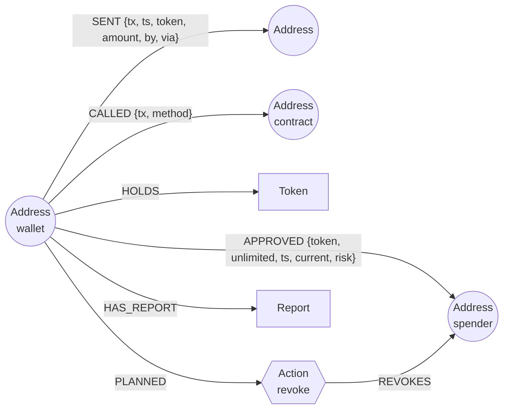

# Postmortem

**Why did my money move?** Postmortem loads a wallet's on-chain history into a FalkorDB graph and lets an agent walk it. It tells you which outflows you signed, which were swaps, and which were **pulled by someone else through an approval you gave months ago**. It shows the exact graph path behind each answer, follows the money to where it came to rest, scores what is still exposed, and then acts: it drafts the revoke transactions and writes the postmortem back into the graph.

Built for Graph Hacks (FalkorDB x WeMakeDevs), Track 01: Agents That Act on Connected Data.

- Live demo: `<your Railway URL>`
- Demo video: `<your video link>`
- MCP endpoint: `<your Railway URL>/mcp`

## Why a graph

"Where did my money go" is a multi-hop question. An unlimited approval granted in March, a contract that used it in September, a transaction signed by a stranger, and an exchange two hops later are four facts in four places. In a table they are four lookups and a join you have to know to write. In the graph they are one path:

```
(you)-[:APPROVED {USDC, unlimited}]->(spender)
(you)-[:SENT {900 USDC, by: stranger, via: spender}]->(stranger)-[:SENT]->(exchange)
```

Postmortem's tools are Cypher over that graph, and every answer returns the path that proves it.

## The graph



- One graph per chain (`postmortem_ethereum`, `postmortem_base`, …), so addresses never collide across networks.
- Every `SENT` edge carries `by` (who signed the transaction) and `via` (which contract it called). That is what separates "you sent it" from "it was taken".
- Range indexes on `Address.addr`, `Token.addr`, `Tx.hash`, `SENT.tx` and `CALLED.tx`.

## What the agent can do

| Tool | What it does in the graph |
| --- | --- |
| `load_wallet` | Pulls token transfers, native and internal transfers, transactions, approvals and balances from Blockscout and writes them with `UNWIND … MERGE`. Looks up the signer of every outflow the wallet did not sign. |
| `wallet_overview` | Activity window, holdings, and the most central counterparties by `algo.pageRank` over `SENT`. |
| `explain_outflows` | Classifies each outflow: **swap** (same tx paid something back), **sent** / **contract call** (the wallet signed), **pulled by approval** (someone else signed, and an `APPROVED` edge to the called contract allowed it). Returns the approval path for each pull, plus gas. |
| `who_can_spend` | Blast radius. Every approval, re-checked on-chain (`allowance`, `isApprovedForAll`, Permit2), with what is reachable right now and a risk score: unlimited, unverified or plain-account spender, explorer tags, unused for 90+ days, has pulled before. Writes the score back onto the edge. |
| `trace_funds` | Follows a token up to 3 hops. The agent **expands the graph as it goes**, fetching each recipient's onward transfers, then returns time-ordered paths (`all(i IN range(...) WHERE rs[i].ts <= rs[i+1].ts)`) and where the money rested. |
| `connection_path` | `shortestPath` over `SENT|CALLED|APPROVED` in both directions. |
| `query_graph` | Read-only Cypher (runs through `GRAPH.RO_QUERY`) for anything else. |
| `plan_revokes` | **Acts.** Drafts the exact revoke calls (`approve(spender, 0)`, `setApprovalForAll(op, false)`, `Permit2.approve(token, spender, 0, 0)`) and records each as an `(:Action)` node linked to the wallet and spender. Nothing is signed or sent. |
| `write_postmortem` | **Acts.** Writes the report (what happened, pulls with their approval, what is still exposed, the fixes) and saves it as a `(:Report)` node. |

### How it decides

- **Run postmortem** needs no LLM. The graph picks the route: a pull found by `explain_outflows` triggers `trace_funds` on that token, and a live high or medium risk approval triggers `plan_revokes`.
- **Ask the graph** uses any OpenAI-compatible model with tool calling (Gemini, OpenAI, OpenRouter, Groq). The model chooses tools from their descriptions; the UI shows each tool call with its Cypher and its path.
- **MCP:** the same nine tools are served over MCP at `/mcp` (streamable HTTP) and over stdio (`npm run mcp`), so Claude Desktop, Cursor or any MCP client can pick them.

## Run it locally

```bash
docker run -p 6379:6379 -it --rm falkordb/falkordb:latest
cp .env.example .env        # add GEMINI_API_KEY or another key if you want "Ask the graph"
npm install
npm run local               # http://localhost:8787
```

Tests run against a real FalkorDB (they skip if none is reachable) on a synthetic wallet in Blockscout's response shapes:

```bash
FALKORDB_URL=redis://127.0.0.1:6379 npm test   # 11 tests
```

### MCP client config (stdio)

```json
{
  "mcpServers": {
    "postmortem": {
      "command": "npx",
      "args": ["tsx", "/path/to/postmortem/src/mcp-stdio.ts"],
      "env": { "FALKORDB_URL": "redis://127.0.0.1:6379" }
    }
  }
}
```

## Deploy on Railway

1. New project → **Deploy a Docker image** → `falkordb/falkordb:latest`. Name the service `FalkorDB`. Add a volume at `/var/lib/falkordb/data`.
2. New service from this GitHub repo. `railway.json` sets the start command and health check.
3. On the app service, set `FALKORDB_URL=redis://${{FalkorDB.RAILWAY_PRIVATE_DOMAIN}}:6379` and, optionally, `GEMINI_API_KEY`.
4. Generate a domain for the app service. `/api/health` should show `"falkordb": true`.

FalkorDB Cloud works too: set `FALKORDB_URL=rediss://default:<password>@<host>:<port>`.

## Known limitations

- Approvals are read from transactions the wallet sent (`approve`, `increaseAllowance`, `setApprovalForAll`, Permit2 `approve`). Off-chain signatures (EIP-2612 `permit`, Permit2 signatures) are not seen until they are used.
- Smart-contract wallets (Safe, 4337 accounts) are signed by a relayer or bundler, so their outflows look pulled. Postmortem is built for regular accounts.
- History is paged (300 items per list by default). Outflows older than the loaded transaction history are marked as such instead of being guessed.
- Dollar values use today's price from the explorer, not the price on the day of the transfer.
- Data comes from public Blockscout instances and public RPCs, which rate-limit. Busy wallets take longer.

## Stack

FalkorDB (Cypher, range indexes, `shortestPath`, `algo.pageRank`) · Node 22 + TypeScript · Hono · MCP TypeScript SDK · Blockscout API v2 · vis-network for the path view.

## License

MIT, see [LICENSE](LICENSE).
