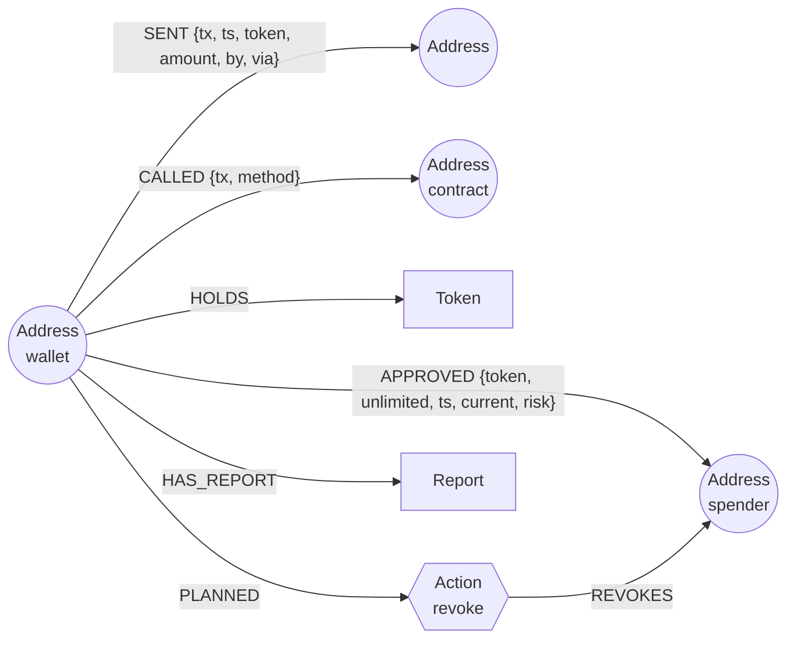

# Postmortem Remembers

**Why did my money move, and has this spender done it before?** Postmortem loads a wallet's on-chain history into a FalkorDB graph and lets an agent walk it. It tells you which outflows you signed, which were swaps, and which were **pulled by someone else through an approval you gave months ago**. It shows the exact graph path behind each answer, follows the money to where it came to rest, scores what is still exposed, and then acts: it drafts the revoke transactions and writes the postmortem back into the graph.

Postmortem started at Graph Hacks (FalkorDB x WeMakeDevs). **Postmortem Remembers**, built for Tatum's Total Recall (Walrus Memory), gives it long-term memory: every postmortem is written to Walrus, and before the agent judges any spender it checks the spender's record. A drainer that emptied one wallet last week is a drainer on the next wallet it appears in. Chain reads go through Tatum's gateways with one key, and each memory is stamped with the Sui checkpoint current when it was written.

- Live demo: https://postmortem-production-1cd2.up.railway.app
- Demo video: https://youtu.be/p02M6iydamc
- Write-up: https://x.com/Rav3nlaud3/status/2111791707888951348
- MCP endpoint: `https://postmortem-production-1cd2.up.railway.app/mcp`

## Why a graph

"Where did my money go" is a multi-hop question. An unlimited approval granted in March, a contract that used it in September, a transaction signed by a stranger, and an exchange two hops later are four facts in four places. In a table they are four lookups and a join you have to know to write. In the graph they are one path:

```
(you)-[:APPROVED {USDC, unlimited}]->(spender)
(you)-[:SENT {900 USDC, by: stranger, via: spender}]->(stranger)-[:SENT]->(exchange)
```

Postmortem's tools are Cypher over that graph, and every answer returns the path that proves it.

## The graph



- One graph per chain (`postmortem_ethereum`, `postmortem_base`, …), so addresses never collide across networks.
- Every `SENT` edge carries `by` (who signed the transaction) and `via` (which contract it called). That is what separates "you sent it" from "it was taken".
- Range indexes on `Address.addr`, `Token.addr`, `Tx.hash`, `SENT.tx` and `CALLED.tx`.

## What the agent can do

| Tool | What it does in the graph |
| --- | --- |
| `load_wallet` | Pulls token transfers, native and internal transfers, transactions, approvals and balances from Blockscout and writes them with `UNWIND … MERGE`. Looks up the signer of every outflow the wallet did not sign. |
| `wallet_overview` | Activity window, holdings, and the most central counterparties by `algo.pageRank` over `SENT`. |
| `explain_outflows` | Classifies each outflow: **swap** (same tx paid something back), **sent** / **contract call** (the wallet signed), **pulled by approval** (someone else signed, and an `APPROVED` edge to the called contract allowed it). Returns the approval path for each pull, plus gas. |
| `who_can_spend` | Blast radius. Every approval, re-checked on-chain (`allowance`, `isApprovedForAll`, Permit2), with what is reachable right now and a risk score: unlimited, unverified or plain-account spender, explorer tags, unused for 90+ days, has pulled before. Writes the score back onto the edge. |
| `trace_funds` | Follows a token up to 3 hops. The agent **expands the graph as it goes**, fetching each recipient's onward transfers, then returns time-ordered paths (`all(i IN range(...) WHERE rs[i].ts <= rs[i+1].ts)`) and where the money rested. |
| `connection_path` | `shortestPath` over `SENT|CALLED|APPROVED` in both directions. |
| `query_graph` | Read-only Cypher (runs through `GRAPH.RO_QUERY`) for anything else. |
| `plan_revokes` | **Acts.** Drafts the exact revoke calls (`approve(spender, 0)`, `setApprovalForAll(op, false)`, `Permit2.approve(token, spender, 0, 0)`) and records each as an `(:Action)` node linked to the wallet and spender. Nothing is signed or sent. |
| `write_postmortem` | **Acts.** Writes the report (what happened, pulls with their approval, what is still exposed, the fixes), saves it as a `(:Report)` node, and **remembers it**: the incident and one record per spender go to Walrus Memory. |
| `check_record` | **Memory.** Everything Walrus holds about one address, from every wallet Postmortem has ever looked at, folded into a credibility score (100 clean, 0 drainer). `who_can_spend` calls this for every spender and raises the risk of anyone with a record. |
| `memory_ledger` | **Memory.** The index of what was written: blob ids, namespaces, Sui checkpoints. |

### Memory: the Law Merchant's record check

Medieval trade fairs ran on a rule: before you dealt with a stranger, you paid a small fee to check the merchant court's record of them. Nobody could make you deal fairly; everybody could see whether you had.

Postmortem's memory is that record, held on Walrus so it outlives any one server:

- **Two namespaces.** `incidents` holds one memory per postmortem (wallet, chain, findings). `counterparties` holds one memory per spender judged: verdict (`pulled`, `tagged`, `high`, `medium`, `low`, `clean`), how much it pulled, from which wallet, in how many transactions.
- **Readable and exact.** Each memory is one plain sentence plus the record as JSON. Recall works by meaning (the sentence); scoring parses the JSON, so nothing is approximate.
- **Recall before verdict.** `who_can_spend` calls `check_record` on every spender. A record of pulling funds adds to the risk score and the reasons list, and the UI says so: "0x1111… has a record: seen in 2 prior postmortems across 2 wallets; pulled funds 2 times".
- **Credibility** = 100, minus 40 per pull verdict, 35 per explorer-tagged, 15 per high, 5 per medium, 10 per extra wallet it appears in; plus 5 per clean and 2 per low. Clamped 0 to 100.
- **Idempotent writes.** The report id is the idempotency key, so re-running a wallet does not double-count its spenders.
- **Stamped in time.** With a Tatum key, every write carries `sui_checkpoint`, the latest Sui checkpoint at write time, so a memory can be placed against the chain Walrus settles on.
- **No keys, still works.** Without `MEMWAL_*` the SDK's in-memory mock runs. The header pill says `memory: mock`. With them, it says `Walrus mainnet` and every ledger row links to its blob on Walruscan.

### How it decides

- **Run postmortem** needs no LLM. The graph picks the route: a pull found by `explain_outflows` triggers `trace_funds` on that token, and a live high or medium risk approval triggers `plan_revokes`.
- **Ask the graph** uses any OpenAI-compatible model with tool calling (Gemini, OpenAI, OpenRouter, Groq). The model chooses tools from their descriptions; the UI shows each tool call with its Cypher and its path.
- **MCP:** the same eleven tools are served over MCP at `/mcp` (streamable HTTP) and over stdio (`npm run mcp`), so Claude Desktop, Cursor or any MCP client can pick them.

## Run it

**Everything in one command (Docker):**

```bash
cp .env.example .env        # optional: add GEMINI_API_KEY for "Ask the graph"
docker compose up --build   # app on http://localhost:8787, FalkorDB browser on http://localhost:3000
```

**Without Docker for the app:**

```bash
docker run -p 6379:6379 -d falkordb/falkordb:latest
cp .env.example .env
npm install
npm run local               # http://localhost:8787
```

**Check live data before a demo.** This is read-only: it calls Blockscout, the chain RPC and FalkorDB and prints PASS or FAIL for each.

```bash
npm run smoke -- ethereum 0xYourWallet
```

**Tests** run against a real FalkorDB (they skip if none is reachable) on a synthetic wallet in Blockscout's response shapes. CI runs them on every push with a FalkorDB service container.

```bash
FALKORDB_URL=redis://127.0.0.1:6379 npm test   # 11 tests
npm run typecheck
```

### MCP client config (stdio)

```json
{
  "mcpServers": {
    "postmortem": {
      "command": "npx",
      "args": ["tsx", "/path/to/postmortem/src/mcp-stdio.ts"],
      "env": { "FALKORDB_URL": "redis://127.0.0.1:6379" }
    }
  }
}
```

## Deploy on Railway

1. New project → **Deploy a Docker image** → `falkordb/falkordb:latest`. Name the service `FalkorDB`. Add a volume at `/var/lib/falkordb/data`.
2. New service from this GitHub repo. `railway.json` sets the start command and health check.
3. On the app service, set `FALKORDB_URL=redis://${{FalkorDB.RAILWAY_PRIVATE_DOMAIN}}:6379` and, optionally, `GEMINI_API_KEY`.
4. Generate a domain for the app service. `/api/health` should show `"falkordb": true`.
5. Open the app service's shell (or run locally with the same env) and run `npm run smoke -- ethereum 0xYourWallet` once.

The `Dockerfile` also runs anywhere that takes a container (Fly.io, Render, a VPS); point `FALKORDB_URL` at your FalkorDB.

FalkorDB Cloud works too: set `FALKORDB_URL=rediss://default:<password>@<host>:<port>`.

## Memory: do X, see Y

```bash
# 1. No keys: the mock
npm test
#   see: test/memory.test.ts, 5 passed (render/parse, remember+recall, credibility, tools, Sui stamp)

# 2. Live keys (memory.walrus.xyz → account + delegate key; dashboard.tatum.io → API key)
cp .env.example .env   # fill MEMWAL_ACCOUNT_ID, MEMWAL_PRIVATE_KEY, TATUM_API_KEY
npm run dev
#   see: header pill "memory: Walrus mainnet · Sui stamp via Tatum"

# 3. Run a postmortem on a drained wallet, then check a spender
#   see: write_postmortem step data.memory = { incident: <blob id>, counterparties: [...] }
#   see: Memory panel lists each write with "blob …" linking to walruscan.com and "sui #<checkpoint>"
#   Type the drainer's address into "Check an address's record" → "pulled funds 1 time · credibility 60/100"

# 4. Run a second wallet the same drainer hit
#   see: who_can_spend now says "has a record: seen in 1 prior postmortem" and raises the risk before any pull is found here
#   Check the record again → "2 wallets, pulled 2 times · credibility 10/100"

# 5. From any MCP client
#   check_record {"address":"0x…"} → the same record; memory_ledger {} → the index
```

## Known limitations

- Approvals are read from transactions the wallet sent (`approve`, `increaseAllowance`, `setApprovalForAll`, Permit2 `approve`). Off-chain signatures (EIP-2612 `permit`, Permit2 signatures) are not seen until they are used.
- Smart-contract wallets (Safe, 4337 accounts) are signed by a relayer or bundler, so their outflows look pulled. Postmortem is built for regular accounts.
- History is paged (300 items per list by default). Outflows older than the loaded transaction history are marked as such instead of being guessed.
- Dollar values use today's price from the explorer, not the price on the day of the transfer.
- Data comes from public Blockscout instances and public RPCs, which rate-limit. Busy wallets take longer. A `TATUM_API_KEY` moves the RPC reads to Tatum's gateways.
- Memory holds verdicts, not proof. The proof stays in the graph and on-chain; a record says "Postmortem judged this address before", and `check_record` returns the blob ids so anyone can read the original memory.
- Anyone running their own Postmortem with their own Walrus account has their own record. A shared, public record across instances is the obvious next step (one namespace, many writers).

## Configuration

All settings are environment variables; `.env.example` lists them with defaults. The ones that matter: `FALKORDB_URL`, `MEMWAL_ACCOUNT_ID` + `MEMWAL_PRIVATE_KEY` (Walrus Memory; mock without them), `TATUM_API_KEY`, one LLM key (`GEMINI_API_KEY`, `OPENAI_API_KEY` or `LLM_API_KEY` + `LLM_BASE_URL`), `LLM_MODEL`, `INGEST_PAGES`, `RUNS_PER_HOUR`, and per-chain `BLOCKSCOUT_<CHAIN>` / `RPC_<CHAIN>` overrides.

## Project layout

```
src/
  server.ts            web app, SSE streams, /mcp endpoint, health check
  mcp.ts, mcp-stdio.ts MCP server (streamable HTTP and stdio)
  agent/               LLM tool loop, no-LLM autopilot, model config
  tools/index.ts       the eleven tools (nine graph, two memory)
  graph/               FalkorDB connection, ingest, path views
  memory/memwal.ts     Walrus Memory: remember, recall, the record check, the local ledger
  sources/             Blockscout API v2, JSON-RPC readers, Tatum gateways + Sui checkpoint
public/index.html      the UI (vendor libraries served from /vendor)
scripts/smoke.ts       live connectivity check
test/                  synthetic fixtures and tests
docs/                  demo plan and submission notes
```

## Stack

FalkorDB (Cypher, range indexes, `shortestPath`, `algo.pageRank`) · Walrus Memory (`@mysten-incubation/memwal`) · Tatum RPC gateways (EVM + Sui) · Node 22 + TypeScript · Hono · MCP TypeScript SDK · Blockscout API v2 · vis-network for the path view.

## License

MIT, see [LICENSE](LICENSE).
